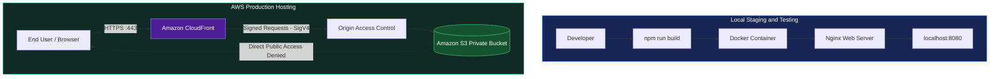

# Portfolio-
# Cloud-Hosted Personal Portfolio Website

A personal portfolio website deployed on AWS using Amazon S3 and Amazon CloudFront, with secure origin access and Docker-based local testing.


## Project Overview

This project demonstrates the deployment of a personal portfolio website using AWS cloud services. It focuses on static website hosting, secure content delivery, containerization, access control and deployment using AWS CLI.

The website's production files are stored in a private Amazon S3 bucket and delivered to users through Amazon CloudFront. Docker and Nginx are used separately to containerize and test the website locally before deployment.

## Live Website

**Portfolio:** https://harshitanegi.netlify.app/

## Architecture

The project uses two separate workflows: 

### 1. Local Staging & Container Validation

1. Generate production files using `npm run build`.
2. Build a Docker image containing the website.
3. Use Nginx to serve the static files.
4. Access the container locally through port 8080.

### 2. AWS Production Cloud Hosting

1. A user requests the website through HTTPS.
2. Amazon CloudFront receives the request.
3. CloudFront retrieves website files from Amazon S3.
4. Origin Access Control (OAC) signs requests using AWS Signature Version 4.
5. The S3 bucket policy allows access only from the authorized CloudFront distribution.

### Architecture Diagram



## AWS Services and Their Purpose

| Service | Purpose |
|---|---|
| Amazon S3 | Stores static website files such as HTML, CSS, JavaScript and images. |
| Amazon CloudFront | Distributes website content through global edge locations and provides HTTPS delivery. |
| Origin Access Control (OAC) | Secures communication between CloudFront and the private S3 origin using signed requests. |
| AWS IAM | Controls permissions for AWS users and deployment operations. |
| S3 Bucket Policy | Restricts object access to the authorized CloudFront distribution. |

### How the Services Interact

**1. Amazon S3**

- Stores the production build files.
- Block Public Access remains enabled.
- Acts as a private origin for CloudFront.

**2. Amazon CloudFront**

- Acts as the Content Delivery Network (CDN).
- Delivers cached website content to users.
- Supports HTTPS using SSL/TLS.
- Reduces repeated requests to the S3 origin through caching.

**3. Origin Access Control (OAC)**

- Signs CloudFront requests using AWS Signature Version 4.
- Allows CloudFront to retrieve files from the private S3 bucket.
- Prevents users from accessing the S3 origin directly.

**4. AWS IAM and S3 Bucket Policy**

- IAM manages permissions for AWS operations.
- The S3 bucket policy grants `s3:GetObject` access to the CloudFront service principal.
- Access is restricted to the specific CloudFront distribution ARN.

**5. Docker and Nginx**

- Docker packages the website into a container.
- Nginx serves the production files inside the container.
- Local testing is performed through port 8080.
- This workflow is separate from the S3 and CloudFront production hosting architecture.

## Technologies Used

| Category | Technologies |
|---|---|
| Cloud Platform | Amazon Web Services |
| Storage | Amazon S3 |
| Content Delivery | Amazon CloudFront |
| Access Control | AWS IAM, OAC, S3 Bucket Policy |
| Containerization | Docker |
| Web Server | Nginx |
| Deployment | AWS CLI |
| Version Control | Git, GitHub |
| Operating System | Linux |

## Deployment Workflow

### Prerequisites

Install and configure:

- AWS CLI
- Docker
- Git
- Node.js and npm
- An AWS account with the required permissions

### 1. Generate Production Build

From the project directory:

```bash
npm install
npm run build
```

The build command generates production-ready website files.

Verify the output directory. For the current project configuration, it is:

```text
dist/portfolio/browser/
```

### 2. Containerize the Website

Build the Docker image:

```bash
docker build -t portfolio-website .
```

Run the container:

```bash
docker run -d -p 8080:80 --name portfolio portfolio-website
```

Open the website:

```text
http://localhost:8080
```

Check running containers:

```bash
docker ps
```

View container logs:

```bash
docker logs portfolio
```

Stop the container:

```bash
docker stop portfolio
```

### 3. Configure AWS CLI

Configure AWS CLI with your authorized AWS credentials:

```bash
aws configure
```

Verify the active AWS identity:

```bash
aws sts get-caller-identity
```

This helps confirm which AWS account and identity are being used.

### 4. Create AWS Infrastructure

Using the AWS Management Console:

1. Create an Amazon S3 bucket.
2. Keep Block Public Access enabled.
3. Create a CloudFront distribution.
4. Select the S3 bucket as the origin.
5. Configure Origin Access Control (OAC).
6. Allow CloudFront access through the S3 bucket policy.
7. Configure the distribution to redirect HTTP requests to HTTPS.

The S3 bucket should not be configured for public website access.

### 5. Deploy Website Files to Amazon S3

Upload the production build:

```bash
aws s3 sync dist/portfolio/browser/ \
s3://YOUR-BUCKET-NAME/ \
--delete
```

The `sync` command compares local and remote files and uploads changes. The `--delete` option removes remote files that are no longer present locally, so verify the destination before running it.

### 6. Invalidate CloudFront Cache

After uploading updated website files:

```bash
aws cloudfront create-invalidation \
--distribution-id YOUR-DISTRIBUTION-ID \
--paths "/*"
```

This requests CloudFront to refresh its cached content.

### 7. Verify Deployment

Open the CloudFront distribution URL in a browser.

Check:

- Website accessibility.
- HTTPS connection.
- CSS and JavaScript loading.
- Images and downloadable files.
- Updated website content after cache invalidation.
- Direct S3 access remains restricted.

## Verification and Troubleshooting

| Issue | Possible cause | Troubleshooting |
|---|---|---|
| 403 Forbidden | Incorrect bucket policy or OAC configuration | Verify CloudFront distribution ARN and bucket policy. |
| 404 Not Found | Incorrect file path or missing index file | Verify uploaded files and default root object. |
| Old website content | CloudFront cached previous files | Create a cache invalidation. |
| CSS or images not loading | Incorrect asset paths | Check browser developer tools and build output. |
| Docker container unavailable | Container stopped or port conflict | Check `docker ps` and container logs. |
| AWS Access Denied | Insufficient IAM permissions | Verify the active identity and required permissions. |

## Security Considerations

- Keep Amazon S3 Block Public Access enabled.
- Use CloudFront Origin Access Control for private S3 access.
- Follow the principle of least privilege when assigning IAM permissions.
- Never commit AWS credentials or access keys to GitHub.
- Avoid storing sensitive configuration files in the repository.
- Use HTTPS for public website access.
- Verify AWS account identity before running deployment commands.

## Cost Considerations

The project uses managed AWS services, but charges may apply.

| Service | Potential costs |
|---|---|
| Amazon S3 | Storage, requests and data transfer. |
| Amazon CloudFront | Requests and data transfer. |
| AWS CLI | No separate CLI usage fee; underlying AWS operations may incur charges. |
| Docker | Local Docker usage does not itself create AWS hosting charges. |

Monitor usage through AWS Billing and AWS Budgets. Check current AWS pricing and free-tier eligibility before deployment.

## Key Learnings

Through this project, the following concepts are explored:

- Static website hosting using Amazon S3.
- Content delivery through Amazon CloudFront.
- Private origin access using OAC.
- IAM permissions and S3 bucket policies.
- Production builds and static asset deployment.
- Containerization using Docker.
- Serving static files through Nginx.
- AWS CLI operations and deployment verification.
- CloudFront caching and invalidation.
- Basic cloud security and cost awareness.

## Future Improvements

- Automate website deployment using GitHub Actions.
- Configure secure GitHub-to-AWS authentication using OIDC.
- Add deployment validation and automated tests.
- Explore AWS monitoring and logging services.
- Improve cache policies and deployment workflows.

*These are planned improvements, not currently implemented features.*

## Author

**Harshita Negi**


---

*This repository documents the implementation, deployment process, configuration and technical learnings of my personal cloud-hosted portfolio project.*

